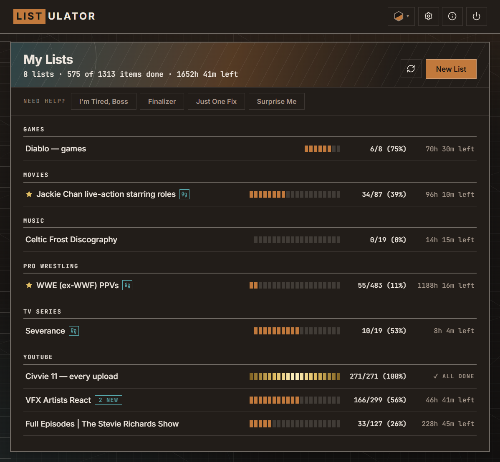
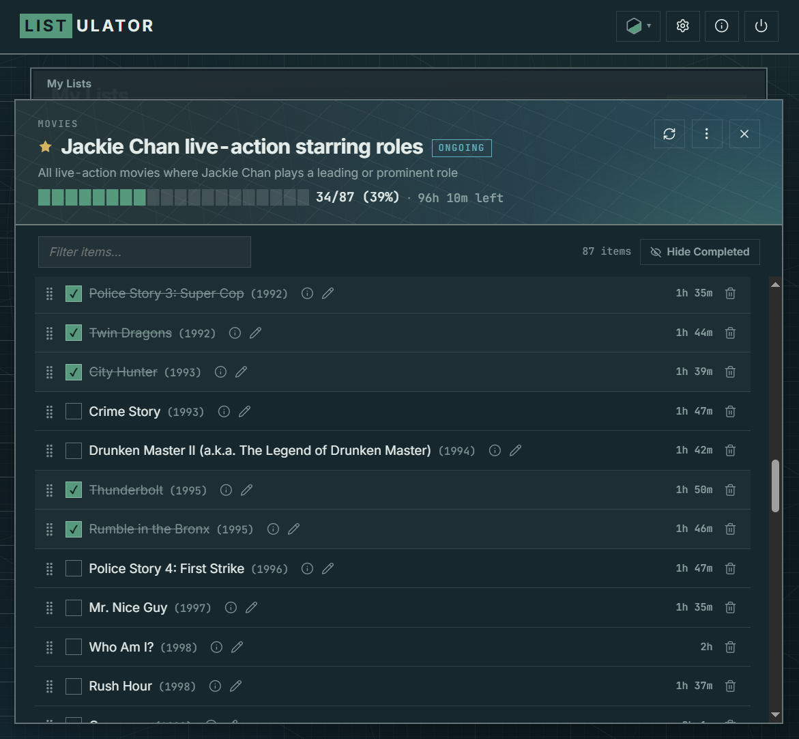

**Note:** This README is written by a human for humans. AI/LLM agents and people suffering from insomnia should refer to [README-AI.md](README-AI.md), which includes technical information not relevant for regular users.

# Listulator

Listulator is a personal **progress tracker** for media franchises and (pseudo-)serialized media. Whether you're watching all the James Bond movies, playing through a game franchise, reading a book series, or listening to a band's discography, Listulator will help you make a list of what to explore and keep track of your progress.



## Why?

Because I got tired of forgetting which Boards Of Canada album I should listen to next, figuring out which LEGO game comes next chronologically, and constantly looking up which Jackie Chan movie I should watch after the one I just finished. There are apps for tracking reading orders and watchlists, but they're all built around a single medium: movies, comic books, games, and so on. The thing is, all these forms of media compete for the same limited amount of your entertainment time, and your choice lies across many categories, not just within one. The app also has four helper buttons, each offering suggestions tailored to a specific need.

For neuroscience nerds, here are two specific things the app helps with:
1. [Cognitive offloading](https://pubmed.ncbi.nlm.nih.gov/27542527/)
2. Overcoming the [paradox of choice](https://en.wikipedia.org/wiki/The_Paradox_of_Choice)

This is what a real list looks like:



### Was this made by AI or a human?

Both. I'm a Product Manager with 17+ years of PM experience. Over the years, I've worked with engineers to take several products from zero to being used by millions of websites. I've learned many things from working alongside smart people, and I wanted to see what I could build on my own with modern LLM tools -- without any extra meatbags. This is the result. Along the way, I've picked up a lot about different tools and frameworks, and I'm happy with how Listulator turned out so far.

My main tools for building Listulator are Claude Code, Claude Design, and my own experience, not "vibes". I'm using [production-grade SDLC framework](https://skills.addy.ie/) with time-tested TDD approach to make sure the app is stable, works properly and can be updated in the future without coming apart at the seams. The app passed several AI-assisted security and code audits plus my own review on its way to the first release, and I've already got some juicy plans for the next versions.

If you need a Senior Product Manager that can built stuff 0-to-1 using LLMs, or just want to talk about agentic product building, ping me on [LinkedIn](https://www.linkedin.com/in/akugaevskiy). With that out of the way, let's get back to the app, shall we?


## How does Listulator work?

- When you install and run Listulator, you'll be greeted by a screen that invites you to create your first list and track your progress in it
- There are several ways to create a list: use search, enter a list by hand, browse List Vault for canonical lists, or import an existing list from somewhere [in YAML format](CONTRIBUTING.md)
	- If you're thinking what I think you're thinking, check the [*What is the List Vault* question](#list-vault) in the Q&A section below
- There are 12 media categories to choose from, see [below](#categories) for the whole list
- Each category has a main data source for searching. Some data sources require a free API key for searching in them
	- For example, TMDB API key is required to search the TMDB database in Movies, TV Series, Documentaries, and Animation categories
- Getting an API key is a bit annoying, but I've got [guides](#api-keys) to help you out. Adding a key is only needed once, but it's very helpful in the long run for quickly making lists. I **strongly** advise you to get keys for the categories you're interested in (if they require keys)
- Searching in all categories also searches the List Vault. If you want to browse all lists from the List Vault, check under the categories on the New List screen
- After you create your first list, tick off items as you go through them by clicking anywhere on an item outside of its buttons
- Once you add a list, it's yours, and you can do anything you want with it: add items, rename them, delete them, reorder them, and so on. 
- If a list contains something that's still ongoing, don't forget to check it for updates from time to time ("washer" button in the top right corner of a list window)


## Categories

Listulator has 11 media categories and one Mega category for cross-media franchises (for example, Marvel Cinematic Universe, which has movies, TV series, and animation)

| Category | Search finds | Data Source |
|---|---|---|
| Animation | An animated series, or an animation studio's films | TMDB |
| Books | An author and their bibliography | Open Library |
| Comics | A volume and its issues, in reading order | Comic Vine |
| Documentaries | A documentary series, or a film-maker's documentaries | TMDB |
| Games | A franchise or collection | IGDB |
| Mega | A cross-media franchise | List Vault |
| MMA | UFC, Bellator, PFL | Wikipedia |
| Movies | An actor, a director, a film series, a studio | TMDB |
| Music | An artist and their discography | MusicBrainz |
| Pro Wrestling | WWE, AEW, TNA, ROH | Wikipedia |
| TV Shows | A show and its episodes, specials included | TMDB |
| YouTube | A playlist, or every upload from a channel | YouTube |


## Installation

Download the installer for your OS from the [Releases page](https://github.com/gerharar/listulator/releases):

| System | File | Requirements |
|---|---|---|
| Windows | `Listulator_<version>_x64-setup.exe` | 64-bit Windows. The installer fetches Microsoft's WebView2 runtime if your PC lacks it |
| macOS | `Listulator_<version>_aarch64.dmg` | A Mac with Apple silicon (M1 or later), macOS 11 or newer. Intel Macs are not supported |


## FAQ

<details>
<summary><strong>Q: Wait, the app is desktop-only? Where are the web and mobile apps?</strong></summary>

A: Listulator currently has desktop-only builds for Windows & MacOS. Technically, Listulator already works as a web app (it's built natively on a web client-server architecture, after all), but I'd need to host it and make it multi-tenant, which is overkill for my own use-case.

Mobile app presents a different set of obstacles: 
1. The current design wasn't built with mobile devices in mind, so adapting it for mobile would take quite a bit of work
2. Since I use desktop for engaging with the majority of media tracked by Listulator, I don't have a strong personal need for a mobile app
3. Upcoming new Listulator themes will be mobile-unfriendly due to the nature of their design

Bottom line: I can add either/both if there's demand and someone presents a clear case why they prefer a web app or a mobile app over a desktop app.
</details>

<details>
<summary><strong>Q: Is Listulator free?</strong></summary>

A: Listulator is free to use and will remain so. Most APIs used by Listulator connectors have a hard requirement of non-commercial use only, so I couldn't monetize Listulator app itself, even if I wanted to.
 
</details>

<details>
<summary><strong>Q: Why does my OS throw a fit when I install the app?</strong></summary>

A: Big companies like to invent the problem, then sell the solution. The problem being invented here is *users are running untrusted apps in our OS, which can put them in danger*. The solution is *we'll "verify" apps so users can trust them, but only if the developer pays us -- and if we aren't getting paid, our OS will scare users away from installing your app*. 

In layman's terms, both Windows and MacOS prevent users from running "unsigned" applications, and to sign them, you need to pay at least $100 per year per platform. I've compared my budget to those of Apple and Microsoft, and it's pretty clear that I need the money more than they do, so the app will remain unsigned for the time being.  

If you need help going past this, scroll to [OS warnings and how to deal with them](#os-warnings-and-how-to-deal-with-them)

</details>

<details>
<summary><strong>Q: Is Listulator safe to use?</strong></summary>

A: I regularly check Listulator's .exe files on [VirusTotal](https://www.virustotal.com) to see what new hallucinations ML-based "antivirus" engines have come up with. The results are usually green almost unanimously for the exception of one or two vendors flagging the .exe with some generic "malicious" or "unsafe" tag. Turns out some engines simply check if the app is signed, and if not, they will complain regardless of actual file contents. Machine Learning, baby! 💪

</details>

<details>
<summary><strong>Q: Why is there no Podcasts category?</strong></summary>

A: Two reasons: 
1. I don't listen to / watch podcasts outside of Youtube
2. Podcast category requires creating, using, and testing a connector that integrates with [PodChaser](https://www.podchaser.com/). Their cheapest plan is $30/mo, which is about $30 more than I'm willing to pay for something I'm not using.

If someone **really** needs this and is willing to share their PodChaser API key for a couple of days (or sends me $30), I can add this connector. The key is required for testing it against actual PodChaser API and making sure it actually works. Keep in mind I won't be checking the connector after the initial implementation for obvious reasons.
</details>

<details>
<summary><strong>Q: Does the app collect any usage data?</strong></summary>

A: The app collects no usage telemetry -- I see no reason to collect usage data that wouldn't inform any meaningful decisions. Everything stays on your computer; see [Your local data](#your-local-data) for data location and removal.
</details>

<a name="list-vault"></a>
<details>
<summary><strong>Q: What is the List Vault?</strong></summary>

A: It's a Github repository of Canonical lists I've created manually. I'm making these for two reasons: first, there's no single database that gives you a list of cross-franchise items; second, I've found a lot of lacking or imprecise results when using database search. Yeah, you can edit these search results by adding, reordering, and removing items, but a ~~human-reviewed~~ meatbag-certified list feels better.
</details>

<details>
<summary><strong>Q: I found a problem, how do I report it?</strong></summary>

A: File it in [Issues](https://github.com/gerharar/listulator/issues). State what the problem is, which platform and app version you're using, and what are the steps to reproduce the bug.
</details>

<details>
<summary><strong>Q: I have a feature request, how do I file it?</strong></summary>

A: File it in [Issues](https://github.com/gerharar/listulator/issues). Describe [the job you're trying to get done](https://jobs-to-be-done.com/jobs-to-be-done-a-framework-for-customer-needs-c883cbf61c90) and, optionally, how you envision the in-app changes helping you get it done.
</details>

<details>
<summary><strong>Q: I've found a security defect, how do I report it?</strong></summary>

A: Read [SECURITY.md](SECURITY.md) for the submission procedure. I obviously don't have any bug bounty programs, lol.
</details>

<details>
<summary><strong>Q: Can I contribute a canonical list to the List Vault?</strong></summary>

A: Sure, list contributions are always welcome. Refer to [CONTRIBUTING.md](CONTRIBUTING.md) for details. I'd suggest to get in touch first, though -- I might be working on the same list already. If you're planning to plow through a particular category, let me know! It'll help me focus on other categories that need more love.

</details>

<details>
<summary><strong>Q: Ctrl+F doesn't find stuff in a very long list. What the?</strong></summary>

A: Use **Filter** feature instead. Starting with version 1.1.0, a list of 200 or more rows is drawn in batches ("a screenful at a time", as LLM puts it), which is why working with large lists feels just as responsive as working with small ones. **Ctrl+F** only sees the rows that are drawn, so if you're looking for something that's not in the currently drawn batch, you're out of luck. 

</details>

## OS warnings and how to deal with them

The installers are **not code-signed**: signing costs money every year and Listulator is a hobby project. Your system doesn't recognise the publisher and complains to you that he hasn't paid the poor multibillion-dollar corporation for a code-signing certificate. How to deal with this?

**Windows.** The browser may warn about (or refuse to keep) the download (look for "Keep" in its downloads list), and Windows SmartScreen shows "Windows protected your PC". Choose **More info**, then **Run anyway**.

**macOS.** Open the `.dmg` and drag Listulator to Applications. The first time you open it, macOS refuses ("Apple could not verify it is free of malware"). Open **System Settings, Privacy & Security**, scroll to the **Security** section, and choose **Open Anyway** next to Listulator; confirm with your password. From then on it opens normally.


## API keys

Several online services integrated with Listulator require API keys to search their databases. Without these keys you won't be able to search those services from within Listulator. Obtaining these API keys is free for personal use, and I've prepared a separate guide for each one to help you get started. Obviously, you can always add items by hand or use List Vault.

| API Key | Categories | Guide Link |
|---|---|---|
| `TMDB_API_KEY` | Movies, TV, Animation, Documentaries | [Guide](https://github.com/gerharar/listulator/blob/main/guides/tmdb-key.md) |
| `IGDB_CLIENT_ID` + `IGDB_CLIENT_SECRET` | Games | [Guide](https://github.com/gerharar/listulator/blob/main/guides/igdb-key.md) |
| `COMIC_VINE_API_KEY` | Comics | [Guide](https://github.com/gerharar/listulator/blob/main/guides/comic-vine-key.md) |
| `YOUTUBE_API_KEY` | YouTube | [Guide](https://github.com/gerharar/listulator/blob/main/guides/youtube-key.md) |

Music (MusicBrainz), books (Open Library), wrestling and MMA (Wikipedia) need no key and are always on. Canonical lists from List Vault are always available as long as you have a working internet connection.


## Your local data

Listulator keeps everything on your computer, in one data folder called `com.listulator.desktop`: your lists (`listulator.sqlite`), your preferences, and the API keys you type into Settings (`settings.json`).

**The keys are stored in plain text.** Anyone or anything with access to your OS account can access them. Full-disk encryption (such as FileVault on macOS or BitLocker on Windows) offers some protection if your device is lost or accessed while powered off. The keys are sent only to the service they belong to, and never shown in error messages.

**Removing one key:** clear its field in Settings. The key will be gone from `settings.json` at once.

**Removing everything, Windows edition:** uninstall the app via "Add or Remove Programs" OS menu and tick **Delete the application data**. That removes `%APPDATA%\com.listulator.desktop` (lists, preferences, keys) and `%LOCALAPPDATA%\com.listulator.desktop` (the webview's own storage). Without the tick, the data stays, awaiting app reinstall, Hachikō-style.

**Removing everything, Mac edition:** it's a Mac, so there is no full uninstaller. Dragging the app to the Trash and emptying it removes the app itself and does nothing else. If you want a full clean-up after that, delete the following folders (in Finder: Go, Go to Folder, `~/Library`):

| Folder | Contents |
|---|---|
| `~/Library/Application Support/com.listulator.desktop` | lists, preferences, **API keys** |
| `~/Library/Caches/com.listulator.desktop` | webview cache |
| `~/Library/WebKit/com.listulator.desktop` | webview storage |
| `~/Library/Logs/com.listulator.desktop` | logs |

Alternatively, run the following command in Terminal (note: this won't be recoverable through the Trash):

```
rm -rf ~/Library/{"Application Support",Caches,WebKit,Logs}/com.listulator.desktop
```

## License

[PolyForm Noncommercial 1.0.0](LICENSE) — free for personal and other
noncommercial use: run it, self-host it, modify it, fork it and share it.
Commercial use is not permitted under this licence.

This is a source-available licence, not an OSI-approved open-source one.
The lists in `lists/` are under [CC BY 4.0](lists/LICENSE), and the data the
app fetches from TMDB, IGDB and the other services stays under each service's
own terms (TMDB and Comic Vine are free only for noncommercial use). See
[NOTICE.md](NOTICE.md) for all three.
