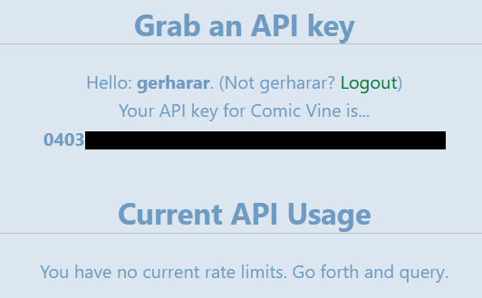

# Get a Comic Vine key

- **Used for:** searching comics
- **Site:** [Comic Vine (comicvine.gamespot.com)](https://comicvine.gamespot.com/api)
- **Last checked:** 28 Oct 2026

## 1. Create a GameSpot account and go to API page

Comic Vine uses GameSpot accounts. Create one, sign in, and either follow [the link](https://comicvine.gamespot.com/api) or hit API in the website footer:

## 2. Copy the API key

Your key is printed at the top of the page:

## 3. Copy the key into Listulator

Go to **Settings** in Listulator, paste the key into the *Comic Vine* row and press **Test**. The app should say **Working**. Enjoy searching Comic Vine in Listulator!
