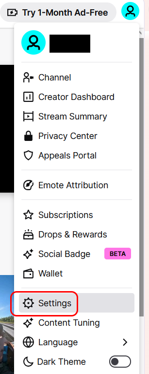
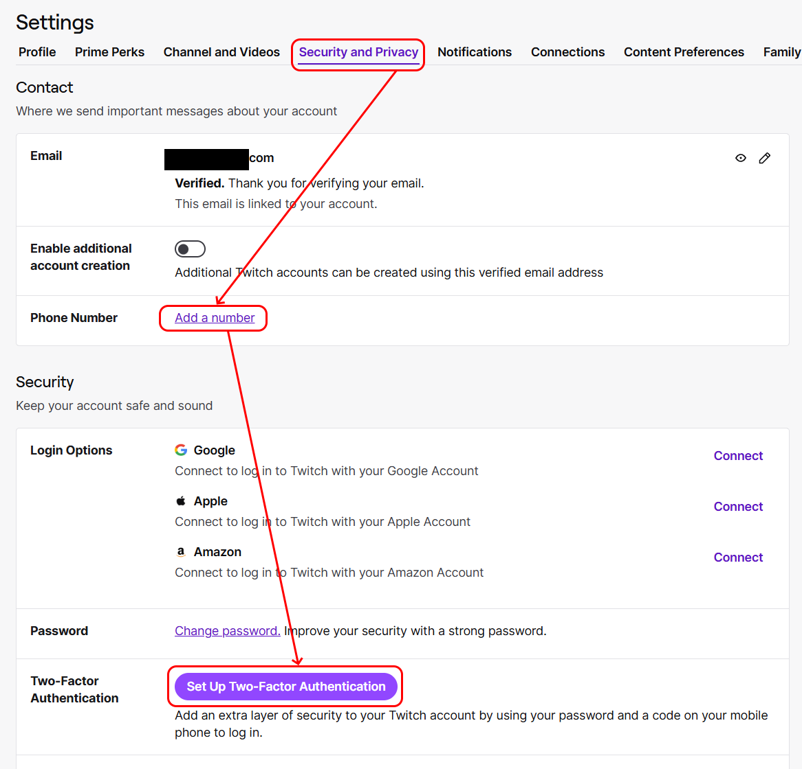
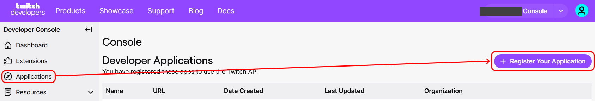
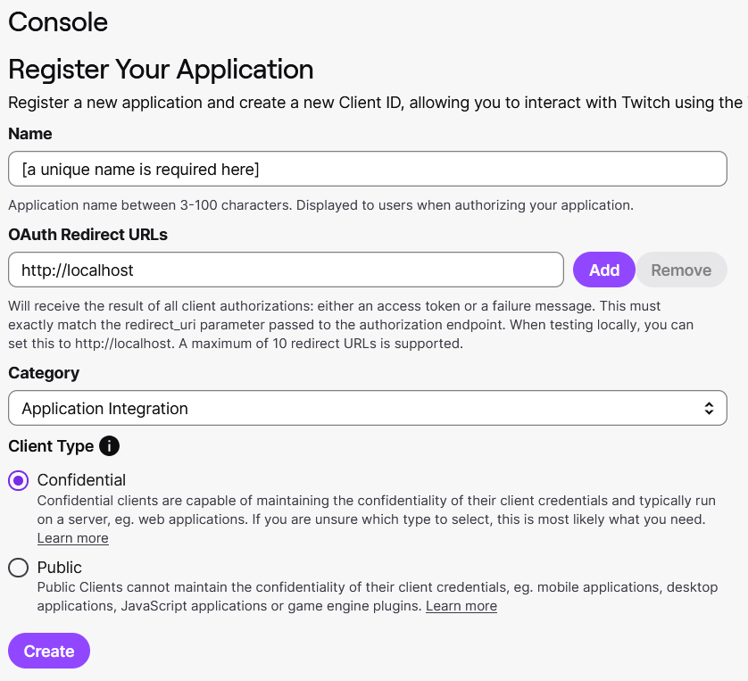
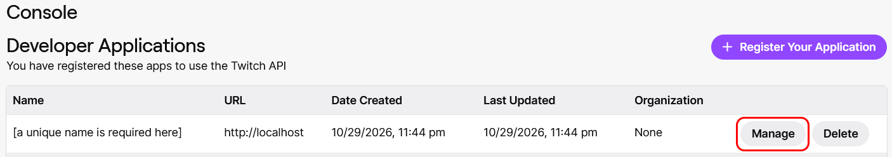
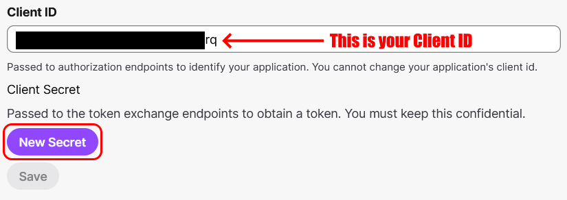

# Get an IGDB key

- **Used for:** searching video games
- **Site:** [The Internet Game Database](https://www.igdb.com)
- **Last checked:** 30 Oct 2026

**Note**: IGDB runs on Twitch's authentication, so while the database you'll be searching is IGDB, the key is created in Twitch developer console

## 1. Make a Twitch account and enable two-factor authentication

Create a Twitch account if you don't have it and go to **Settings**:

Open **Security and Privacy**, add your phone number and **Set Up Two-Factor Authentication** (Twitch will not let you create an application without it)

## 2. Register an application

Open the [Twitch Developer Portal](https://dev.twitch.tv/console), go to **Applications** and hit **Register Your Application**:

Provide application details in the form:

- **Name:** *anything (should be something unique)*
- **OAuth Redirect URLs:** `http://localhost`
- **Category:** Application Integration
- **Client type:** Confidential

## 3. Generate a Client Secret

Click **Manage** next to your application: 

Note your Client ID at the bottom:

Hit **New Secret** under your Client ID:

## 4. Copy both into Listulator

You're almost done. Go to **Settings** in Listulator, paste both *Client ID* and *Client Secret* into the *IGDB* row and press **Test**. The app should say **Working**. Enjoy searching IGDB in Listulator!
