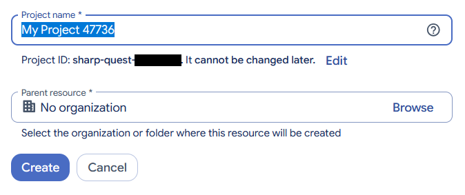
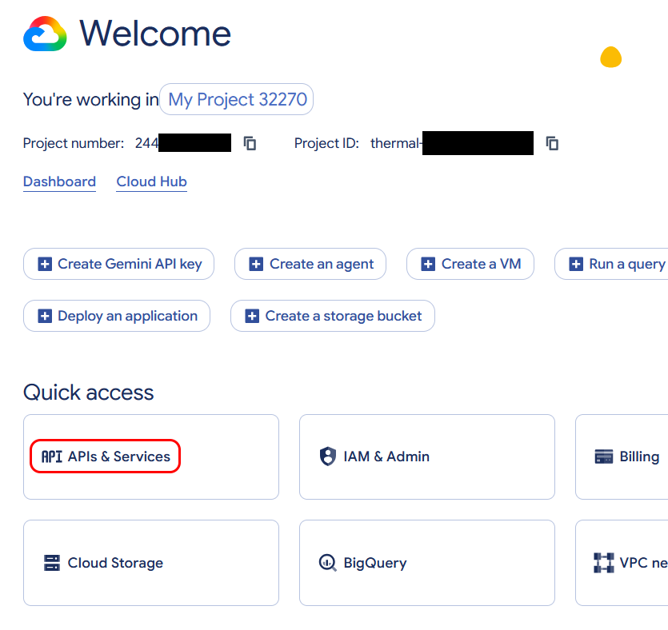
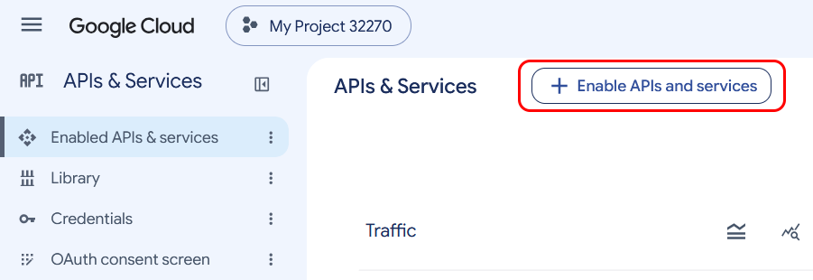
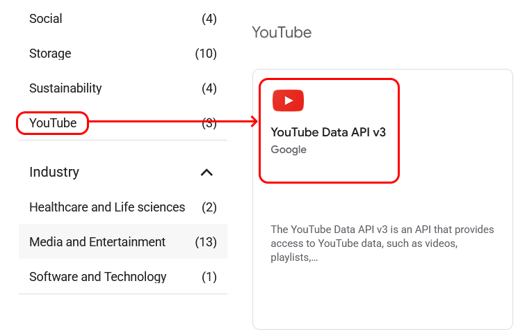
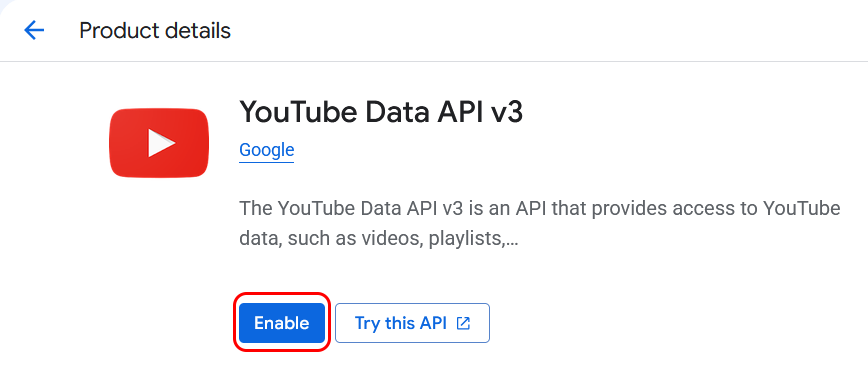
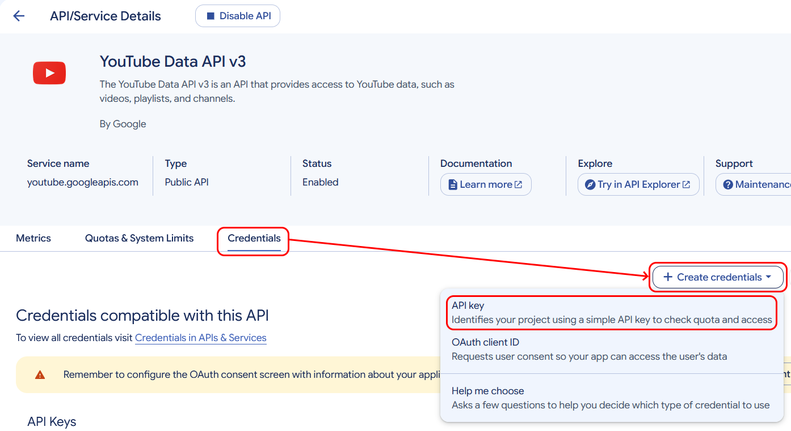
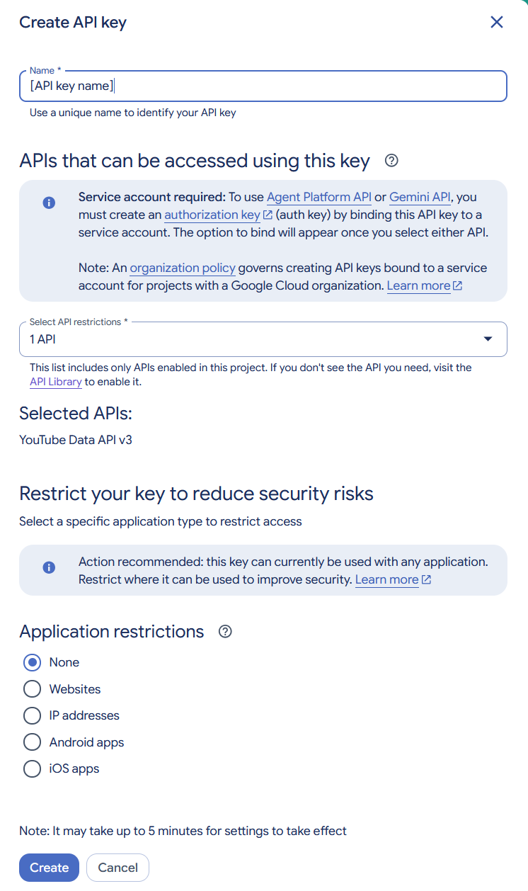
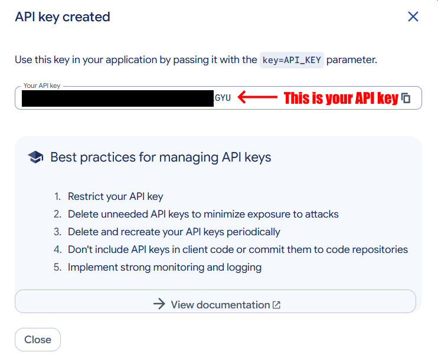

# Get a YouTube API key

- **Used for:** searching YouTube playlists and channels.
- **Site:** [YouTube](https://www.youtube.com/)
- **Last checked:** 30 Oct 2026

YouTube key is issued in Google Cloud console. It is free for personal use.

## 1. Create a project in Google Cloud console

Sign in to your Google account and open the [Google Cloud console](https://console.cloud.google.com). 
**Note 1:** Google now requires to enable 2FA to access Google Cloud console, so you might jump through a series of hoops to enable 2FA first.
**Note 2:** Google Cloud console often creates your first project automatically. If it's not created, hoose **Select a project**, then **New project**:

- **Project name:** anything
- **Parent resource:** anything

## 2. Turn on the YouTube Data API

Open **APIs & Services**:

 Click **Enable APIs & services**:

 Find **YouTube Data API v3** and click on it:
 

Click **Enable**:

(If it's already enabled for whatever reason, click **Manage**)

## 3. Create an API key

Go to **Credentials** tab, click **Create credentials**, then choose **API key** option:

Use the following options for creating the API key:
- **Name:** *anything*
- **API restrictions:** YouTube Data API v3
- **Application restrictions:** none

Your API key should be ready:

## 4. Copy the key into Listulator

You're almost done. Go to **Settings** in Listulator, paste your API key into the *YouTube* row and press **Test**. The app should say **Working**. Enjoy searching YouTube in Listulator!